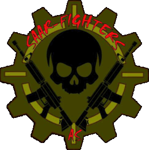

<div align="center">



# Saar-Fighters OS

**Der einfache Vereinsdesktop auf Arch Linux.**

[](https://github.com/0Inexis0/saar-fighters-updates/releases/latest)


[**ISO herunterladen**](https://github.com/0Inexis0/saar-fighters-updates/releases/latest) · [Installation](docs/installation.md) · [Verein](https://www.saarfighters-as.de/)

</div>


Spotify, Firefox und Dateien auf einen Klick. WLAN, Bluetooth und Lautstärke direkt erreichbar. Matte Olive-Optik, große Buttons und gemeinsame Updates für System und Oberfläche.

## Loslegen

**Neuer Rechner:** Im [Release](https://github.com/0Inexis0/saar-fighters-updates/releases/latest) das Download-Skript starten. Es lädt und verbindet die ISO-Teile automatisch. Die fertige ISO auf einen USB-Stick schreiben, starten und installieren – Spotify ist dabei, die Installation geht offline.

**Arch bereits installiert:**

```bash
curl -fsSL https://raw.githubusercontent.com/0Inexis0/saar-fighters-updates/main/system/setup-arch.sh | sudo bash
```

Der Einzeiler fragt vor Änderungen nach und formatiert keine Laufwerke. Das Wartungspasswort legst du selbst fest. Updates benötigen keinen GitHub-Login.

> **ISO:** x86_64 · 4 GB RAM · 32 GB Laufwerk · USB ab 8 GB · Secure Boot aus. Der grafische Installer löscht das ausgewählte Ziellaufwerk.

---

[Installation im Detail](docs/installation.md) · [Bildnachweise](docs/assets.md) · [MIT-Lizenz](LICENSE)
