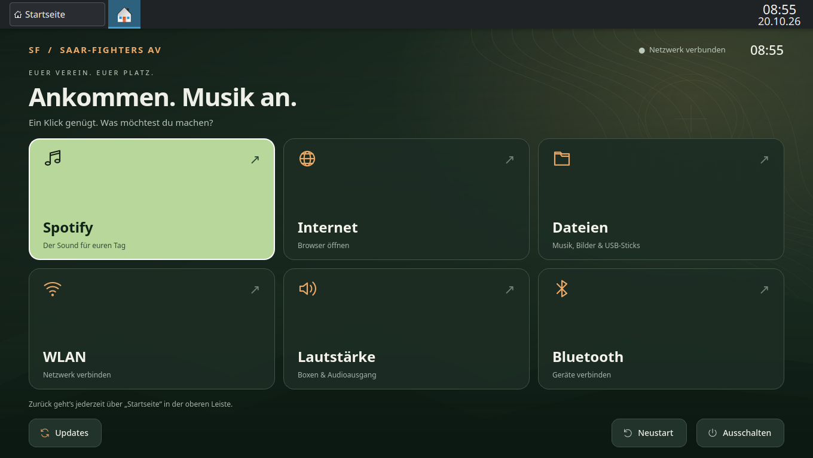

# Saar-Fighters OS

Eine einfache Vereinsoberfläche für **Saar-Fighters AS e.V.**, auf Arch Linux.
Große Schaltflächen statt eines vollgepackten Desktops. Matte Olive-, Khaki- und Erdtöne ohne Konturen oder Leuchteffekte;
der skalierbare Flecktarn-Hintergrund
ist Bestandteil des Projekts. Das Original-Logo stammt von der
[Vereinswebseite](https://www.saarfighters-as.de/) (siehe [Bildnachweis](assets.md)).



**Status: Installierbare Live-ISO 0.2.0 mit deutscher Oberfläche.**
Die normale Vereinsnutzung benötigt kein Terminal. Die Wartung der
Arch-Basis übernimmt eine zuständige Person.

## Auf dem Vereinslaptop installieren

Die ISO startet zunächst zum Ausprobieren. Der Knopf **„Auf diesem Rechner
installieren“** öffnet den eigenen deutschen Installer. Spotify und die
Vereinsoberfläche sind enthalten; die Installation funktioniert ohne Internet.
Das gewählte Ziellaufwerk wird vollständig gelöscht.

Benötigt werden ein x86_64-Rechner mit mindestens 4 GB RAM, ein Laufwerk ab
32 GB und ein USB-Stick ab 8 GB. Secure Boot ausschalten.
Siehe [Installationsanleitung](installation.md),
[ISO-Build](iso-build.md) und [ISO-Testprotokoll](iso-validation-0.2.0.md).
Die große ISO-Datei liegt außerhalb von Git im lokalen
Ordner `build/releases/0.2.0/`; dieses Repository enthält den Quellcode.

## Auf einem bereits installierten Arch einrichten

Im Terminal des vorgesehenen Vereinsrechners:

```bash
curl -fsSL https://raw.githubusercontent.com/0Inexis0/saar-fighters/main/system/setup-arch.sh | sudo bash
```

Benötigt installiertes Arch Linux x86_64, Internet, `curl` und sudo-Rechte.
Der Einzeiler fragt vor Änderungen nach `EINRICHTEN`, installiert die Pakete
inklusive Spotify und lässt dich ein eigenes Wartungspasswort setzen. Er
formatiert keine Laufwerke. SDDM, automatische Anmeldung als `saar`, deutsche
Systemsprache und NetworkManager werden für den nächsten Start eingerichtet.
Bestehende Benutzer und persönliche Dateien bleiben erhalten. Für ein normales
Arbeitsgerät diese Änderungen an Anmeldung und Netzwerk bewusst berücksichtigen.
Konfigurationssicherungen liegen unter `/var/lib/saar-setup-backups/`.
Vorhandene fremde Konten namens `saar`/`wartung` werden nicht übernommen.
Nach erfolgreicher Einrichtung selbst neu starten.

Für einen leeren Rechner stattdessen die ISO auf einen USB-Stick schreiben
und den grafischen Installer verwenden: [Installation](installation.md).

## Bedienung

- Spotify: native Flatpak-App, wenn installiert; sonst Spotify im Browser.
- Internet: Firefox.
- YouTube: große Kachel, öffnet YouTube in Firefox.
- Dateien: Dolphin, unter anderem für Musik und USB-Sticks.
- Einstellungen: zentrale Kachel für WLAN, Bluetooth, Lautstärke und Updates.
  Die Auswahl öffnet die eigenen, einheitlich gestalteten Dialoge.
  WLAN auswählen und Passwort eingeben; Bluetooth suchen, koppeln und verbinden;
  Audioausgang, Lautstärke und Stummschaltung einstellen.
- Statusleiste: Netzwerkverbindung, verbundene Bluetooth-Geräte, Netzteil und
  Akku mit Prozentwert und Ladezustand. Fehlende Hardware und unbekannte Werte
  werden ausdrücklich angezeigt. Details erscheinen beim Darüberfahren.
- Vereinswebseite: große Kachel mit Vereinslogo zur offiziellen Seite.
- Oberfläche, Systemsprachumgebung, Qt-Dialoge und Firefox sind auf Deutsch
  eingestellt. Spotify übernimmt die deutsche Sprachumgebung.
- Updates: sichtbarer Fortschritt, Administratorfreigabe und ehrliche
  Erfolgs-/Fehlermeldung. Aktualisiert das komplette Arch-System und
  systemweit installierte Flatpaks sowie Oberfläche, Taskleiste, Designs und
  Hilfsskripte aus dem festen GitHub-Repository (`main`). Eigene Änderungen
  werden nach einem Neustart aktiv.
- Neustart und Ausschalten: erst nach Bestätigung; Abbrechen ist vorausgewählt.
- **Startseite** in der unteren Leiste bringt die Vereinsoberfläche wieder
  nach vorne. Laufende Apps bleiben über die Leiste erreichbar. Die Leiste
  verwendet den eigenen matten Plasma-Stil „Saar Olive“ mit Khaki-Akzenten.

Der Vereinsbenutzer `saar` meldet sich automatisch an und hat keine
sudo-Rechte. Das separate Konto `wartung` dient zur Administration.
Bei der ISO-Installation wird das Wartungspasswort selbst festgelegt.
Das zufällig erzeugte Passwort der ursprünglichen Entwicklungs-VM liegt
nur lokal in `build/vm/credentials.txt`, nicht im Repository.

## Architektur

Die Oberfläche ist eine native Qt/PySide6-Anwendung. KDE Plasma/Wayland
übernimmt Fensterverwaltung, Audio, Netzwerk und Geräte. Ein angehefteter Taskleisten-Eintrag öffnet die Startseite. Ein Benutzerdienst startet sie beim
Anmelden und startet sie nach einem Absturz erneut. Ein lokaler Socket
verhindert doppelte Instanzen.

Alle Systemaktionen verwenden feste Programme und Argumentlisten. Nur
der Update-Helfer und im Live-System der feste Installationshelfer laufen
mit Adminrechten; die Oberfläche selbst bleibt
unprivilegiert. Ein eigener Python-Prozess spricht über D-Bus mit NetworkManager,
BlueZ und UPower; Audio läuft über PipeWire/PulseAudio. Er hält die Verbindung
für Bluetooth-Suche und Kopplungsabfragen offen. WLAN-Passwörter werden über
die Prozess-Eingabe und D-Bus weitergegeben, nicht als Kommandozeilenargument
oder Logeintrag. NetworkManager speichert das Verbindungsprofil für den
Vereinsbenutzer. Kopplungscodes müssen ausdrücklich bestätigt werden.
Während eines Updates blockiert ein systemd-Inhibitor
normales Herunterfahren und Suspend. Netzwerkprobleme, Paketkonflikte
und abgebrochene Freigaben werden als Fehler behandelt.

## Lokal ansehen

Benötigt Python, PySide6, QtSvg und dbus-next
(unter Arch: `pyside6 qt6-svg python-dbus-next`).
Die Vorschau verändert keine Systemeinstellungen und öffnet keine Apps.

```bash
python app/main.py --preview
QT_QPA_PLATFORM=offscreen python app/main.py --screenshot build/home.png --size 1280x800
python -m unittest discover -s tests -v
```

## Eine neue Test-VM erstellen

Host: KVM/QEMU, libvirt im Benutzermodus, GNOME Boxes, `genisoimage`,
Python/PyYAML und OpenSSL. Eine offizielle Arch-Cloud-QCOW2-Datei und
deren unabhängig geprüfte SHA256-Prüfsumme bereitstellen.

```bash
python scripts/create-vm.py --base /pfad/Arch-Linux-cloudimg.qcow2 --sha256 PRUEFSUMME
virsh -c qemu:///session define build/vm/domain.xml
virsh -c qemu:///session start saar-fighters-os
```

Die VM hat 4 vCPUs, 4 GiB RAM, eine 40-GiB-Sparse-Disk und VirtIO-Grafik.
3D-Beschleunigung ist zunächst ausgeschaltet. Vorhandene VMs werden
nicht verändert. Der Ersteller verweigert das Überschreiben einer
vorhandenen Entwicklungs-VM.

Cloud-init installiert die Basis. Bei fehlendem NTP kann die erste
Initialisierung kurz auf Zeitsynchronisation warten. Spätere Starts
warten nicht auf NTP; der Zeitdienst bleibt im Hintergrund aktiv. Die Host-Zeit lässt sich
über den Gast-Agenten übernehmen:

```bash
virsh -c qemu:///session qemu-agent-command saar-fighters-os '{"execute":"guest-set-time"}'
python scripts/guest.py 'tail -n 10 /var/log/saar-bootstrap.log'
```

Nach `SAAR_BASE_READY`:

```bash
python scripts/deploy-vm.py
python scripts/guest.py 'flatpak install --system --noninteractive flathub com.spotify.Client'
python scripts/guest.py 'systemctl reboot'
```

In Boxen **Saar-Fighters OS** öffnen. Wenn Boxen geschlossen wird, kann
die VM gespeichert/pausiert werden. Zum Fortsetzen wieder öffnen.

## Änderungen ausrollen

```bash
python scripts/deploy-vm.py
python scripts/guest.py 'runuser -u saar -- env XDG_RUNTIME_DIR=/run/user/1000 DBUS_SESSION_BUS_ADDRESS=unix:path=/run/user/1000/bus systemctl --user daemon-reload; runuser -u saar -- env XDG_RUNTIME_DIR=/run/user/1000 DBUS_SESSION_BUS_ADDRESS=unix:path=/run/user/1000/bus systemctl --user restart saar-home'
```

Das Plasma-Layout wird beim ersten Login einmalig erstellt. Für eine
bewusste erneute Anwendung den Marker
`/home/saar/.local/state/saar-layout-v1` entfernen und neu anmelden.

Das Entwicklungsskript `system/install.sh` richtet nur die Oberfläche in
der VM beziehungsweise im ISO-Build ein. Der getrennte Live-Installer unter
`installer/` partitioniert das ausdrücklich ausgewählte Laufwerk und richtet
ein bootfähiges System ein.

## Wartung und Grenzen

- Arch ist ein Rolling Release. Updates vor Vereinsterminen prüfen und ein
  aktuelles VM-/Datenträger-Backup bereithalten. Die Schaltfläche ersetzt
  weder Backups noch die Prüfung von Arch-Meldungen bei größeren Änderungen.
- Der Update-Knopf aktualisiert Pakete, Flatpaks und die eigene Oberfläche von
  dem öffentlichen Repository
  [`0Inexis0/saar-fighters`](https://github.com/0Inexis0/saar-fighters),
  Branch `main`. Auf dem Laptop sind kein Schlüssel und kein GitHub-Login nötig.
  Entwicklung, Tests, ISO-Bauwerkzeuge und Downloads liegen gemeinsam in diesem
  öffentlichen Repository. Änderungen auf `main` stehen direkt für Updates bereit.
  Vor dem Zusammenführen von Änderungen den Workflow „Check launcher“ prüfen.
  Der Download wird auf vollständige Dateien und Syntax geprüft; das allgemeine
  Installationsskript wird dabei nicht erneut ausgeführt. Die vorherige Oberfläche
  bleibt unter `/var/lib/saar-fighters-update/previous` erhalten. Schlägt der
  Dateiaustausch fehl, wird er zurückgerollt. System-/Flatpak-Updates werden dabei
  nicht zurückgerollt. Ein Stromausfall während des Austauschs erfordert eine
  Prüfung durch die Administration anhand von `recovery.json` im selben Ordner.
- Bestehende Installationen mit ISO 0.1.0 benötigen einmalig den neuen Update-Helfer;
  danach aktualisiert dieser auch sich selbst. Ab ISO 0.2.0 ist er enthalten.
  `python system/update_custom.py --check` lädt und prüft GitHub ohne Installation.
- Keine automatische Update- oder Neustartpflicht während der Musiknutzung.
- Das Vereinskonto ist eine Bedienungserleichterung, kein manipulationssicherer
  öffentlicher Kiosk. Über die gestarteten Apps ist normale Computernutzung möglich.
- Spotify muss einmal mit einem geeigneten Konto angemeldet werden.
  Zugangsdaten und Tokens gehören niemals ins Repository.
- VM-Tests ersetzen keine Prüfung des realen WLAN-/Bluetooth-Chips,
  der Boxen, der Akkulaufzeit oder der Leistung des Vereinslaptops.
- Akku-Energiesparen bleibt dem KDE-Standard überlassen. Im Netzbetrieb ist
  automatischer Suspend für das Vereinsprofil deaktiviert.
- Der einfache WLAN-Dialog unterstützt sichtbare Netze mit WPA2/WPA3-Personal
  sowie offene/OWE-Netze. Versteckte Netze, Unternehmensanmeldung (802.1X) und
  Sonderkonfigurationen werden durch die Administration eingerichtet.
- Für Produktion: Hardwaretest, gewünschte Startprogramme,
  Datensicherung und Wiederherstellungsmedium vervollständigen.

## Quellen

- [Vereinswebseite und Original-Logo](https://www.saarfighters-as.de/)
- [Arch-Cloud-Images](https://wiki.archlinux.org/title/Arch_Linux_on_a_VPS)
- [Cloud-init](https://wiki.archlinux.org/title/Cloud-init)
- [KDE Plasma Scripting](https://develop.kde.org/docs/plasma/scripting/api/)
- [Spotify unter Linux](https://www.spotify.com/de/download/linux/)

Siehe [docs/validation.md](validation.md) für den tatsächlich geprüften Stand.

### Updates und Releases veröffentlichen

Es gibt nur ein Repository: [`0Inexis0/saar-fighters`](https://github.com/0Inexis0/saar-fighters).
Änderungen zuerst in einem Branch testen und erst nach erfolgreichem Workflow
„Check launcher“ nach `main` übernehmen. Die Vereinsrechner beziehen ihre
Updates direkt von `main`; ein Export-Repository und ein Deploy-Key sind nicht nötig.
ISO-Dateien weiterhin als Release-Anhänge veröffentlichen, nicht in Git einchecken.
`scripts/package-release.py` erstellt die ISO-Teile und Download-Helfer dafür.

Ältere Installationen und die ISO 0.2.0 enthalten noch die Adresse
`saar-fighters-updates`. Die GitHub-Weiterleitung auf `saar-fighters` bleibt
dafür erforderlich. Nach einem erfolgreichen Update nutzt der Helfer die neue
Adresse direkt. Das alte Repository unter diesem Namen nicht neu anlegen.
