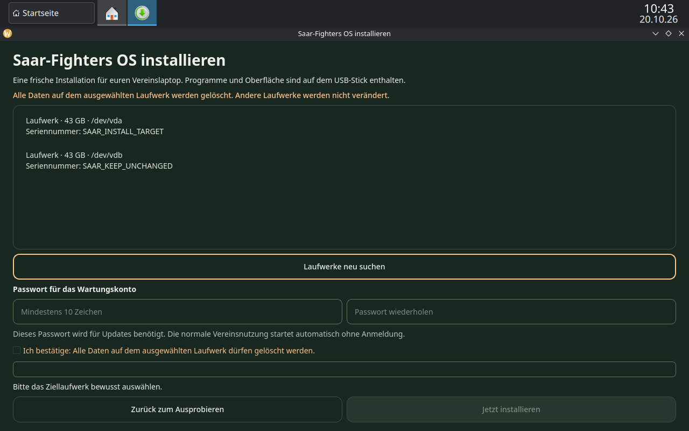
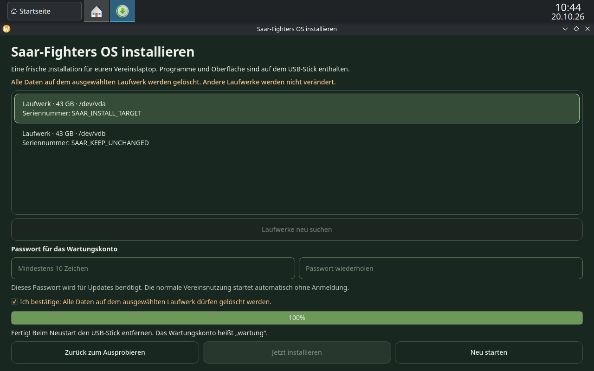
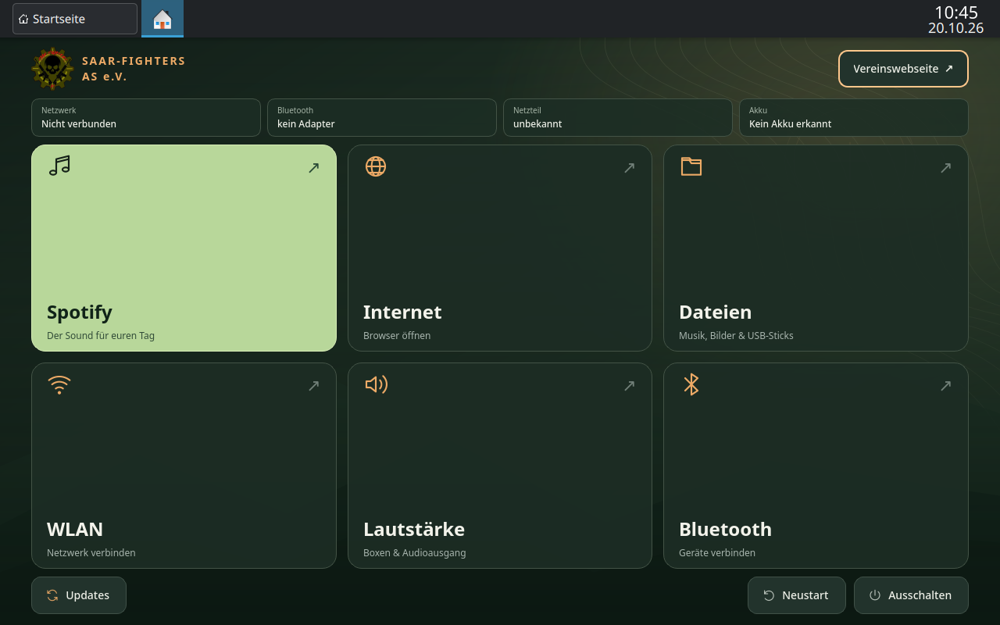
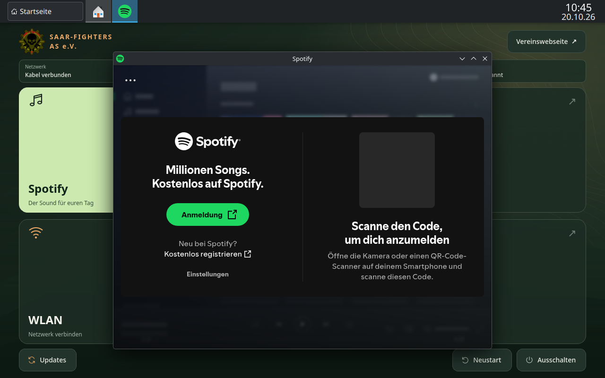

# ISO-Testprotokoll

Build und Prüfung am 20. Oktober 2026.

| Merkmal | Ergebnis |
| --- | --- |
| Datei | `saar-fighters-os-0.1.0-2026.10.20-x86_64.iso` |
| Größe | 3.177.283.584 Bytes, etwa 3,0 GiB |
| SHA256 | `33ffe8d1dbdfc6177819db7c6118511308c3c714875823e8493066723981c3eb` |
| Basis | Arch Linux, Archiso 91-1, SquashFS mit Zstandard |
| Spotify | Flatpak `com.spotify.Client`, Version `1.2.95.453.g0eeebbed` |
| Lokales Ergebnis | `build/releases/0.1.0/`, einschließlich Prüfsumme und Paketlisten |

Die Prüfsumme der heruntergeladenen Datei stimmt mit dem Ergebnis in der
Build-VM überein. Genau diese Datei wurde in beiden abschließenden
Installationstests verwendet.
Die vollständigen [Arch-Paketversionen](iso-arch-packages.txt) und
[Flatpak-Versionen](iso-flatpak-packages.txt) sind mit dokumentiert.

## Installation mit BIOS und UEFI

Zwei eigene KVM-VMs, jeweils 4 GiB RAM, 4 vCPUs und zwei unabhängige
40-GiB-Laufwerke. Der Netzwerkanschluss war während der Installation und
des anschließenden Starts getrennt.

- Live-ISO startet mit deutscher Vereinsoberfläche und eigenem Installer.
- Keine Vorauswahl des Ziellaufwerks. Auswahl anhand von Gerätename,
  Größe und Seriennummer.
- Zwei Passworteingaben, Löschbestätigung und zweite Rückfrage mit
  Laufwerksdaten; „Abbrechen“ ist vorausgewählt.
- Installation auf `SAAR_INSTALL_TARGET` über die tatsächliche Oberfläche,
  in beiden VMs erfolgreich bis 100 Prozent.
- Das zweite Laufwerk `SAAR_KEEP_UNCHANGED` wurde bei ausgeschalteten VMs
  mit seiner Referenz verglichen: `qemu-img compare` meldet für beide
  vollständige Übereinstimmung.
- Anschließend ISO aus dem virtuellen Laufwerk entfernt und vom
  installierten Laufwerk gestartet.

## Prüfung des installierten Systems

`scripts/check-installed.py` hat in beiden VMs alle 16 Prüfungen bestanden:

- Root-Dateisystem tatsächlich auf ext4, keine Live-Umgebung.
- Automatische Anmeldung, SDDM, NetworkManager und Vereinsoberfläche aktiv.
- Deutsche Sprachumgebung vorhanden.
- Spotify samt Laufzeitumgebung installiert; deren Programme sind ausführbar.
- Vereinskonto ohne sudo-Rechte.
- Wartungspasswort gesetzt und tatsächliche sudo-Authentifizierung damit
  erfolgreich. Testpasswort wurde nicht protokolliert.
- Live-Markierung, passwortlose Installerfreigabe und installierter
  Helfereinstieg entfernt.
- Normales Initramfs und EFI-Bootdatei vorhanden, Auslagerungsdatei aktiv.

Firmwaremodus jeweils unabhängig über `/sys/firmware/efi` bestätigt:
ein Start unter BIOS, einer unter UEFI. `systemctl --failed` meldet in
beiden installierten Systemen keine fehlgeschlagenen Systemdienste.
Spotify wurde anschließend in beiden installierten Systemen über die Kachel
gestartet; die Flatpak-Prozesse laufen. Für die zusätzliche Prüfung der
deutschen Anmeldeansicht wurde erst danach das virtuelle Netz der UEFI-VM
aktiviert. Die Ansicht erscheint korrekt; es wurde kein Spotify-Konto angemeldet.

## Automatisierte Prüfungen und Grenzen

43 Python-/Qt-Tests bestanden; Shell-Syntaxprüfung und `git diff --check`
ohne Fehler. Die Installerprüfungen umfassen insbesondere aktive Laufwerke,
Live-USB, Swap/LVM, geänderte Laufwerksidentität, nötige Bestätigungen,
Fehlerbehandlung, kleine Bildschirme und das Freigeben der Laufwerkssperre
vor der udev-Geräteerkennung.

Noch nicht geprüft: ein physischer USB-Start und die konkrete Hardware des
Vereinslaptops, WLAN-/Bluetooth-Verbindungen und Musikwiedergabe über eure
Boxen. Die Installations-VMs haben keine solchen physischen Geräte.
Secure Boot, Dual-Boot und Laufwerksverschlüsselung sind nicht enthalten.
