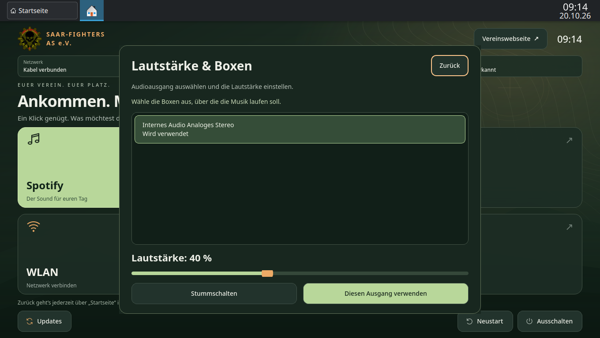
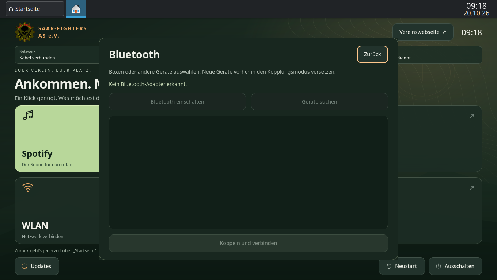

# Teststand

Entwicklung am 20. Oktober 2026. Getestet in einer eigenen KVM-VM,
angezeigt mit GNOME Boxes. Keine Änderung der vorhandenen anderen VMs.

## Automatisiert

`python -m unittest discover -s tests -v`: **43 Tests erfolgreich**.

- Alle sechs großen Kacheln reagieren auf tatsächliche Qt-Mausereignisse.
- Der Vorschaumodus startet keine Programme oder Systemaktionen.
- Bedienelemente passen bei 800×540, 1024×600 und 1366×768.
- Abbrechen von Ausschalten löst keine Aktion aus.
- Auch bestätigter Neustart im Vorschaumodus verändert den Host nicht.
- Unbekannte Power-Aktionen werden abgewiesen.
- Update-Erfolg, Programmabsturz, Fehler und verweigerte Freigabe werden
  voneinander unterschieden.
- Updates rufen ausschließlich den festen privilegierten Helfer auf.
- Fehlende Programme liefern eine sichtbare Rückmeldung.

`bash -n` für Bootstrap, Installation, Erststart und Update-Helfer:
erfolgreich.

Zusätzliche Geräteprüfungen: keine erfundenen Akku-/Adapterwerte; Ladezustände;
WLAN-Verschlüsselung und Passwortgrenzen; Wiederverwendung gespeicherter Profile;
Warten auf tatsächliche Netzwerkaktivierung; D-Bus-Passwortübergabe ohne TTY;
Teilfehler bei der Statusabfrage; Ablehnung nicht angeforderter Kopplungen;
ausdrückliche Codebestätigung; sauberer Suchstopp und Bluetooth-Aus-/Einschalten;
Audio-Lautstärkegrenzen; verständliche Fehler;
fehlende Adapter deaktivieren Aktionen; Antworten nach Dialogschluss werden
ignoriert. Hardwareantworten sind in diesen automatisierten Tests simuliert.

Die drei eigenen Gerätedialoge wurden bei 1024×600 auf passende Geometrie
geprüft. Die Startseite zusätzlich bei 800×540 und 1366×768.

## In der laufenden VM geprüft

- Automatische Anmeldung als `saar`, Plasma/Wayland und Startseite.
- VM mit 4 GiB RAM, 4 vCPUs, VirtIO-Grafik ohne 3D-Beschleunigung.
- Firefox startet über die Internet-Kachel und lädt eine Webseite.
- Rückkehr aus Firefox über das eigene „Startseite“-Plasma-Widget.
  Die Aktivierung verwendet KDEs Task-Modell, damit Waylands
  Fokus-Schutz nicht im Weg steht.
- Spotify Flatpak `com.spotify.Client` installiert, Version
  `1.2.95.453.g0eeebbed`; Start über die Kachel bis zur Login-Ansicht.
- Eigene WLAN-, Bluetooth- und Audiodialoge geöffnet. Keine Weiterleitung
  in KDE-Einstellungsfenster. Fehlende WLAN-/Bluetooth-Adapter werden erkannt.
- Live-Status aus NetworkManager/UPower: Kabelverbindung mit Internet,
  kein Laptopakku, unbekannter Netzteilzustand. Keine Beispieldaten im Echtbetrieb.
- Audio als Benutzer `saar`: vorhandenen Ausgang gelesen, Lautstärke von
  40 auf 35 Prozent geändert, Stummschaltung gesetzt und Audioausgang gewählt.
  Ergebnisse jeweils erneut ausgelesen; ursprüngliche Lautstärke und
  Stummschaltung anschließend wiederhergestellt.
- `locale -a` enthält `de_DE.utf8`; Neustart lädt die deutsche Sprachumgebung.
  Spotify zeigt die Anmeldung auf Deutsch, Firefox nutzt die deutsche Oberfläche.
- Original-Logo eingebunden; Webseitenknopf öffnet die Vereinswebseite.
- Der Update-Dialog öffnet die Polkit-Abfrage für das Konto `wartung`.
  Abbrechen zeigt „Update nicht freigegeben oder abgebrochen“.
- Der Update-Helfer wurde im Gast ausgeführt: kompletter
  `pacman -Syu`-Lauf und `flatpak update --system`, Rückgabewert **0**,
  Erfolgsmarkierung `/var/lib/saar-last-update` geschrieben.
- Der Vereinsbenutzer ist nicht in `wheel`; der Update-Helfer ist
  `root:root`, Modus `0755`; der Anwendungscode ist `root:root`, `0644`.
- Neustart öffnet eine Bestätigung mit vorausgewähltem „Abbrechen“.
- Der bestätigte Neustart wurde tatsächlich ausgeführt; anschließend waren
  SDDM, NetworkManager und `saar-home.service` wieder aktiv und die
  Startseite sichtbar. Die Bildschirmhelligkeit blieb auf 100 %.

## Noch nicht auf echter Hardware geprüft

- Wiedergabe über das konkrete Spotify-Konto und eure installierten Boxen.
- Physisches WLAN, Bluetooth-Pairing und Audioanschlüsse.
- Leistung, Grafiktreiber, Akkubetrieb, Deckelverhalten und Energiesparen
  des Vereinslaptops.
- Bare-Metal-Installation und Wiederherstellung von einem USB-Stick.

Für die installierbare Live-ISO gibt es ein eigenes
[Testprotokoll](iso-validation.md). Der Hardwaretest am Vereinslaptop bleibt
zusätzlich erforderlich.
